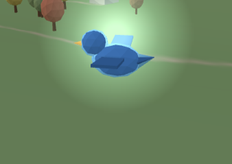
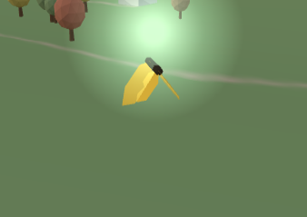
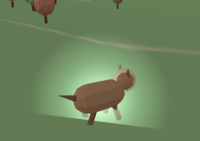
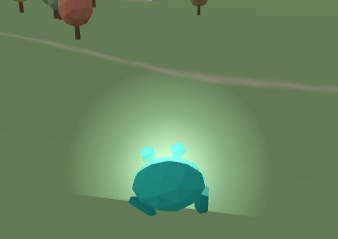
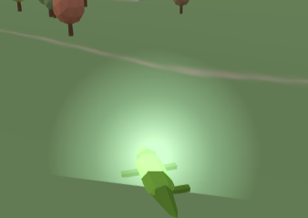
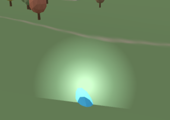
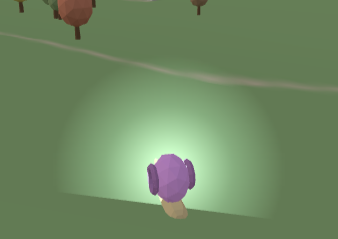
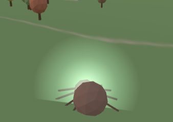
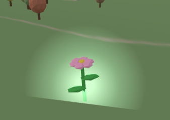
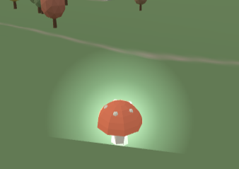

# Creatures in OpenWorld

Every creature you meet in OpenWorld is a **real species that people have actually recorded near
you** (research-grade observations on [iNaturalist](https://www.inaturalist.org), within about
3 km). The game shows each one as a small low-poly figure for its kind of life, with a soft green
glow so you can spot it from a distance. The real species, with a photo, its scientific name and
how often it's recorded around here, is on its card when you find it.

Back to the [full guide](GUIDE.md).

## What each kind looks like

| | | |
|---|---|---|
|  **Birds** flap their wings and bob in the air. |  **Insects** are butterflies with fluttering wings. |  **Mammals** trot on four legs and swish their tails. |
|  **Amphibians** are squat frogs that hop now and then. |  **Reptiles** are low lizards that wiggle. |  **Fish** leap in an arc. |
|  **Molluscs** are snails, stretching slowly. |  **Spiders and their kin** tap their eight legs. |  **Plants** are flowering stems that sway. |
|  **Fungi** are spotted mushrooms. | | |

The figures are the same for every species of a group: a robin and a heron are both "a bird" on
the map. What they are is revealed when you reach them.

## Where they come from

When you play somewhere, the game asks iNaturalist which species have been recorded within about
3 km. Common ones turn up more often; rare ones leave fainter trails and are worth rarer cards.
Around the Royal Observatory in Greenwich, London, for example, the list (November 2026) had
31 plants, 25 birds (Common Wood-Pigeon, Eurasian Magpie…), 17 insects (Jersey Tiger, Western Honey
Bee…), 3 spiders (Cross Orbweaver, Noble False Widow…), 2 mammals (Eastern Gray Squirrel, Red Fox),
a mollusc (Garden Snail) and an amphibian (European Common Frog).

Which kinds appear also depends on the ground you're on (fish and frogs near water, more of
everything in parks and woods than in streets) and the time of day (at night, mostly mammals,
insects, birds and frogs). Only photos whose licence allows use in any app are shown (public
domain, CC BY, CC BY-SA), each credited.

## How you find them

**Animals leave signs.** Every 110 m or so that you walk, the game rolls for wildlife (more often
in green places). When an animal is about, you get "Fresh signs of a bird nearby", and it's hidden
55–110 m ahead of you (rare ones 110–180 m).

- The 🐾 **tracker** at the bottom has five dots that light up as you get closer (250, 150, 90, 50
  and 25 m), with a chime and a buzz at each step.
- A **green glow** on the minimap marks the area it's in, and tightens as you close in.
- Within 90 m, **footprints** appear on the ground, leading towards it.
- At about 24 m (16 m for rare ones) it **shows itself**: the figure appears on the map.
- **Walk up to it**, or **photograph it** in camera view (📷) from up to 40 m.

Go gently. Rushing in (jogging fast in Walk mode, or running with Shift or the joystick pushed
right out in Home and Roam) makes it slip away once, further off. The trail goes cold after 6
minutes (8 for rare ones), or if you walk more than about 420 m away.

**Plants and fungi** don't leave signs or run away: they simply appear a little way ahead of you.

## In camera view

On a phone in Walk mode, 📷 shows the figures standing in the real world through the camera, each
with a "tap to photograph" tag, and a ● on the compass strip at the top for any that are out of
view. Tap one to take its picture.

## Bounties: the game's animal, or a real one

A **bounty** on the Expeditions board is a species really recorded near you, "wanted". Head for
its habitat (the card says where); when you reach it, a card shows where and when to look and
what it is. Then finish it **either way**:

- **🎮 In the game:** follow its signs until the game's one shows itself, and walk up to it or
  photograph it. The longer you search in the right habitat, the likelier it turns up.
- **🌿 For real:** if you see the actual animal, tap **I saw it!** It's on your honour. It adds
  the species to your life list, and the card says *Seen in the wild*. **Log a real sighting on
  iNaturalist** opens iNaturalist with the species filled in, so it can count for science too.
